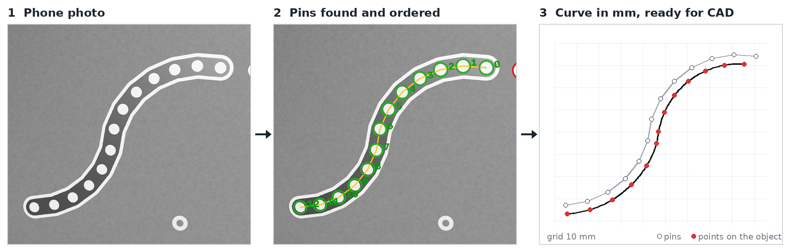
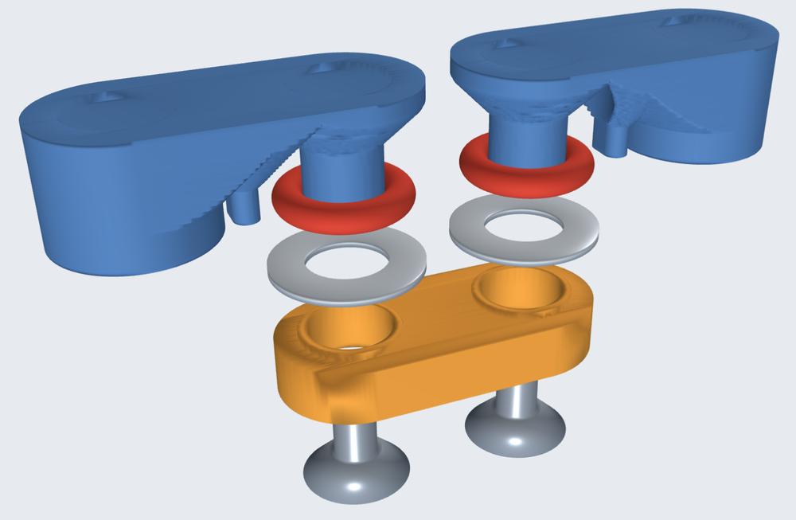
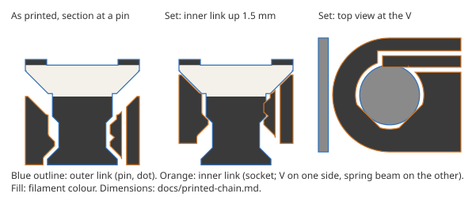
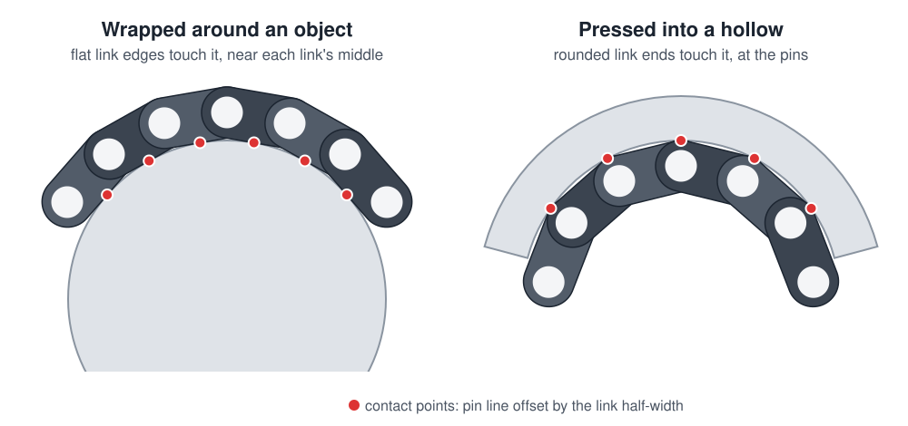
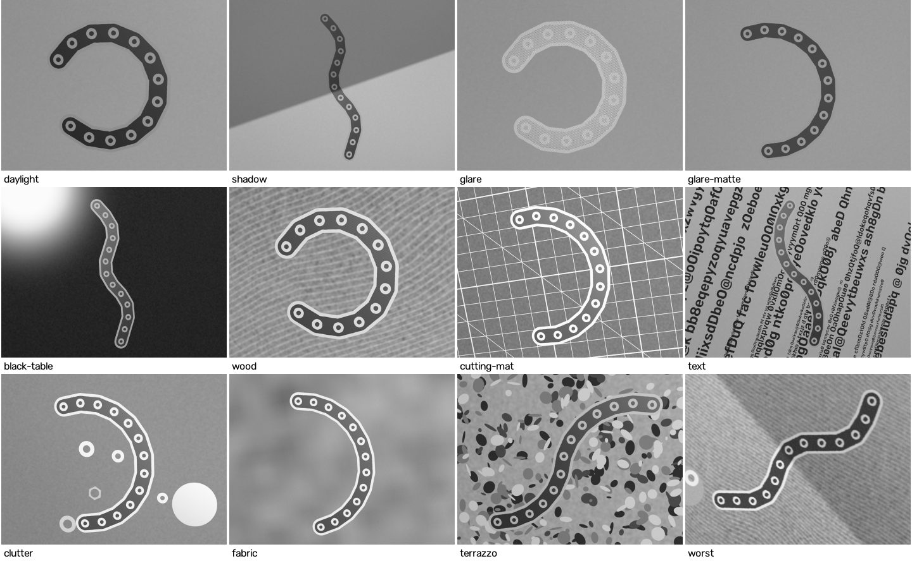

# Spline Wire

**Measure any curve with a 3D-printed chain and a phone photo, then paste it into CAD.**

[](https://github.com/micahflock/spline-wire/actions/workflows/windows-exe.yml)
[](LICENSE)

> Hardware design, direction and testing by me; the software was written with [Claude Code](https://claude.com/claude-code), Anthropic's AI coding agent. [How it was built](#how-it-was-built).


<sub>Simulated photo, from the project's own photo simulator. Real photos are on the way.</sub>

## The problem

Pipe bends, moldings, door handles, the inside of a hollow: curves like these are easy to touch and hard to measure. Calipers give one distance at a time. A profile gauge only works on shallow shapes and still has to be traced. A 3D scan is overkill for one curve, and none of these hands you geometry you can use in a CAD sketch.

Spline Wire aims to get from object to sketch in under a minute: wrap a chain around the object, take a photo, paste the curve.

## Where the idea came from

I needed to measure some molding, and there was a piece of copper wire on my desk. I bent the wire around the molding, laid it down and took a picture. Then I scaled the photo, dropped it into a sketch and traced it with a spline. It worked great.

It was also slow and manual. I had to put something of known size in the photo to scale it, and I traced the curve by hand. The wire itself was a weak point too: a wire springs back a little when you take it off the object.

So I set out to keep what worked and engineer out the friction:

- **The wire became a chain** that holds its shape by friction instead of springing back.
- **The chain is its own ruler.** Its links are exactly 10 mm, so nothing else has to go in the photo.
- **Software does the scaling and tracing.** From photo to sketch is two clicks: Copy points, then Paste points.

Writing that software (computer vision, perspective geometry, a desktop app, a CAD add-in) was a bigger stack than my programming background covers. I wanted to see how far I could get by directing an AI coding agent to build it, while I kept the problem, the design decisions and the hardware.

## How you use it

1. **Wrap.** Press the chain around the curve. Its joints are stiff enough to keep the shape.
2. **Lift and lay flat.** Take it off and lay it on any table, dots up.
3. **Photograph.** Take one photo with the phone's normal camera, straight on or tilted. The phone page sends it to the app on your computer over Wi-Fi (scan a QR code; no phone app, no cloud).
4. **Paste into CAD.** Click **Copy points** in the app, then **Paste points** in Autodesk Fusion. The add-in drops the points and a fitted spline into the sketch you're editing, in millimetres. DXF, SVG (1:1) and CSV files are there for other CAD tools.

No ruler or reference card goes in the photo. The chain is its own scale.

## The chain

The chain is the measuring instrument, and the whole system rests on a few design rules:

- **The pitch is the only critical dimension.** Every link is exactly 10 mm pin to pin. From that, the software works out the camera's angle and distance, and so the true scale (see [below](#how-the-software-works)).
- **One dot on every pin, nowhere else.** The distance between pins never changes as the chain bends. The distance between link centres does.
- **Dots on one face only.** A chain photographed from the back is a mirror image, and a pattern of plain dots can't reveal that.
- **No labels.** The dots are identical 5 mm circles, chosen because they print cleanly with a 0.4 mm nozzle. The software works out their order from geometry alone.
- **Friction, not springs.** The joints hold their pose by friction. Anything elastic springs back when the chain comes off the object and spoils the shape.
- **Stadium-shaped links** (8 mm wide, round ends centred on the pins), so the point where the object touches the chain is predictable.

Two printable designs are generated by code, so the pitch, clearances and hardware sizes are all parameters. Each one starts with a short test piece to check the fits before committing to the full chain.

### Assembled O-ring chain (PETG)



Printed links, screwed together. Each joint uses an M3 countersunk screw, a 4 × 1.5 O-ring and a steel washer, about $0.05 of hardware.

- **No play.** The O-ring presses the inner link's countersink onto the screw head's cone, which centres it whatever size the hole printed.
- **No springback.** The joint turns on steel-on-plastic surfaces, never on the rubber. A twisting O-ring would store a few degrees and give them back.
- **A built-in stop at 74°.** It keeps the pins on either side of a joint at least 1.2 pitches apart, so the software never mistakes a neighbour's neighbour for the next pin.
- **Easy to print.** Everything prints dots up on one bed, without supports, with two filament changes. Each dot is a 0.4 mm window in the black top layer onto white below.

`splinewire oring-chain` also writes an interactive 3D page where you can explode the joint, bend it to its stop and section it through the pins.

### Print-in-place chain



This chain comes off a single-extruder printer already assembled. Print-in-place joints need about 0.3 mm of clearance, and that much play alone would cost about 0.25 mm of accuracy. So after printing, you press each link once. That seats every pin in a rigid V against a printed spring beam, which removes the play, and the same spring provides the friction.

Going back to [where the idea started](#where-the-idea-came-from), I considered running copper wire through the chain to hold its shape, and rejected it on the numbers. Elastic springback of 0.1–0.2° per joint added up to 0.15–0.6 mm of error in simulation, and the wire would fatigue at tight bends.

Full design notes, fits and open risks: [docs/printed-chain.md](docs/printed-chain.md).

## How the software works

The software runs in four steps, each tested on its own:

1. **Find the dots.** Classical computer vision (OpenCV) finds each dot's centre to about 0.1–0.2 pixels. It is built to cope with shadows, glare, wood grain, printed text and look-alike washers on the table.
2. **Put them in order.** Starting from each dot in turn, the software walks one pitch at a time, turning as little as possible. The longest walk is the chain.
3. **Remove the perspective.** All the pins lie on one plane, and each pair of neighbours is exactly one pitch apart. With the phone's focal length (read from the photo's EXIF data), there is only one plane tilt and distance that fits. Thirteen pins give twelve equations for three unknowns, so the solution is well over-determined.
4. **Offset to the contact edge.** The object touches the edge of the chain, not its pin line. Where the chain wraps around the object, the contact is near each link's middle. Where it's pressed into a hollow, the contact is at the pins.



A cubic spline through the contact points is the measured curve.

The app is a small local web server. Its UI runs in the browser on your computer, with a phone upload page reached by QR code. If the detector misses a pin, you click it in the photo: the click snaps to the dot underneath, and if there's no dot to snap to, the pin is placed to fit the chain's pitch.

More detail: [docs/architecture.md](docs/architecture.md).

## Results so far

**First real photo** (printed test plaque, iPhone, indoors on a cluttered desk, camera tilted 25°):

| Pins found | Worst pin error | RMS error | Look-alikes ignored |
|---|---|---|---|
| 13 / 13 | **0.098 mm** | 0.063 mm | 329 |

The target is under 1 mm, so this passes about 10 times over, and it's close to the plaque's own print tolerance. One photo is not a test series: different angles, lighting, shapes and phones are next.

**Simulated photos.** Before anything was printed, I built a photo simulator: realistic FDM print defects, nine table surfaces, clutter, lamp glare, shadows, defocus, hand shake, lens distortion, sensor noise and JPEG compression. Testing against it raised whole-chain detection from 77 to 155 of 167 photos, with a ring-shaped fiducial. The plain dot the chain now uses gets 142 of 167, the price of being easier to print. When the chain is found, the median worst-pin error is 0.023 mm. The remaining failures are one case: a lamp reflected in shiny filament. Matte filament avoids it.



Details, and a comparison of seven fiducial designs for a 0.4 mm nozzle: [docs/cv-robustness.md](docs/cv-robustness.md).

## My role and process

<!-- DRAFT: written from the project history. Edit it into your own words. -->

I came up with the idea, set the requirements (sub-millimetre accuracy, any curve, minimal clicks from object to CAD sketch), made the hardware decisions, and do the printing and physical testing. The project went through three big turns:

- **Labels to no labels.** The first design (April 2026) gave each link a printed ring plus a 7-segment digit, so an AI vision model could read which link was which. Working through the accuracy showed the problem: AI vision models locate points to several pixels at best, which costs a millimetre or more on the curve. Classical computer vision is accurate to fractions of a pixel, so I restarted around unlabeled dots. The chain's own pitch then replaced the reference object.
- **Simulate before printing.** Rather than print and photograph dozens of parts, I had a photo simulator built first. Every change to the detector was measured against 167 simulated photos with known answers. The same simulator settled the fiducial design: a plain 5 mm dot, the easiest to print reliably.
- **Two chain designs.** The print-in-place chain came first, but it relies on thin, finely toleranced spring parts. PETG strings across print-in-place gaps. So I added an assembled design that uses cheap hardware for the precise parts.

Every decision, with the numbers behind it, is recorded in [docs/](docs/). [docs/open-questions.md](docs/open-questions.md) lists what's still unresolved.

## How it was built

I directed the project. Claude Code wrote the software, the simulator and the chain generators, working in cloud sessions on branches that I review and merge. My part was the problem, the requirements, the design calls and trade-offs, and all the physical work: printing, assembly, photos and measurement.

What made this work was a simulator with known answers. Every change could be checked by a number (pin error in millimetres, chains found out of 167) rather than by eye. The test suite has over 250 tests, most of them end to end on synthetic photos with known geometry. [CLAUDE.md](CLAUDE.md) is the project brief the agent works from.

## Try it

**Windows app:** download `SplineWire.exe` from the [latest release](https://github.com/micahflock/spline-wire/releases/latest) and run it. It opens in your browser, and your phone connects by scanning the QR code. Windows may warn that the program is unrecognised, because it isn't code-signed: click **More info → Run anyway**. Inside the app, **Install Fusion add-in…** sets up the Paste points button.

**From source** (any OS with Python 3.12 and [uv](https://docs.astral.sh/uv/)):

```bash
uv sync
uv run splinewire-app                     # the app, at http://localhost:8765/
uv run splinewire measure photo.jpg       # one photo from the command line -> JSON, CSV, DXF, SVG
uv run pytest                             # tests (~1 min)
```

**Print your own:**

```bash
uv run splinewire oring-chain --pins 4    # two-joint O-ring test piece (STLs + printing notes)
uv run splinewire oring-chain             # the full 13-pin chain
uv run splinewire print-chain --pins 3    # one print-in-place test joint
uv run splinewire test-plaque             # a flat test plaque with known geometry, to check accuracy
```

Each command writes STLs (black and white bodies for the filament changes) plus a `PRINTING.txt` with settings and assembly steps. The chain's parameters live in [data/chain.yaml](data/chain.yaml).

## Status

| | |
|---|---|
| ✅ | Detection, ordering, perspective removal and contact offset, validated on simulated photos |
| ✅ | Windows app with phone upload and pin editing; DXF/SVG/CSV export |
| ✅ | Fusion add-in, tested in Fusion: Copy points → Paste points lands the curve in the sketch |
| ✅ | First real photo of the printed test plaque: 0.098 mm worst pin |
| 🔄 | Real-photo test series: angles, lighting, shapes, phones |
| 🔄 | Test chain printed and assembled; real-world testing under way |
| ⬜ | End to end: a real object, measured into a Fusion sketch in under 30 s |

The full plan, in risk order: [docs/next-steps.md](docs/next-steps.md).

## Repository

| Path | What's there |
|---|---|
| [`splinewire/`](splinewire/) | The pipeline (`detect` → `order` → `rectify` → `contact`), the app (`webapp/`), the photo simulator (`scene`) and the chain generators (`oring_chain`, `printed_chain`, `plaque`) |
| [`fusion/SplineWire/`](fusion/SplineWire/) | The Fusion add-in (Paste points) |
| [`data/chain.yaml`](data/chain.yaml) | The chain's physical parameters |
| [`tests/`](tests/) | pytest suite, end to end on synthetic photos |
| [`experiments/`](experiments/) | Standalone studies: detection benchmark, fiducial designs, lens distortion, deskew accuracy |
| [`packaging/`](packaging/) | Windows build (PyInstaller); built, tested and released by GitHub Actions |
| [`docs/`](docs/) | [Architecture](docs/architecture.md) · [Detection robustness](docs/cv-robustness.md) · [Chain designs](docs/printed-chain.md) · [Fusion import](docs/fusion-import.md) · [Next steps](docs/next-steps.md) · [Open questions](docs/open-questions.md) |

## License

[MIT](LICENSE). Built on [OpenCV](https://opencv.org/), [NumPy](https://numpy.org/), [SciPy](https://scipy.org/), [ezdxf](https://ezdxf.mozman.at/) and [Pillow](https://python-pillow.org/).
